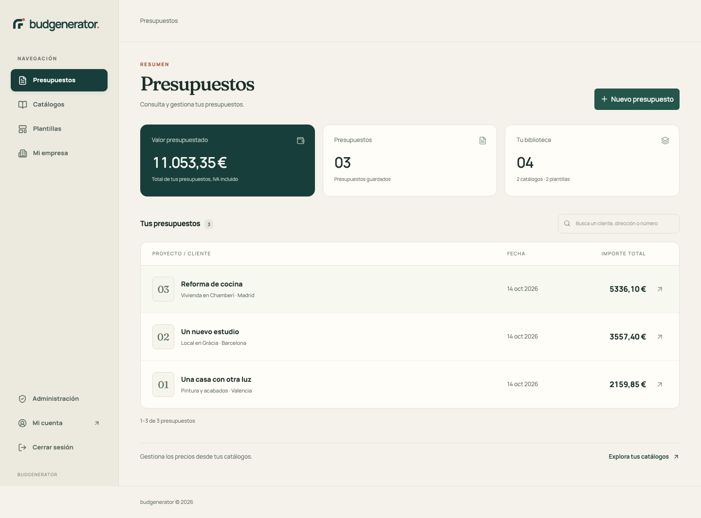
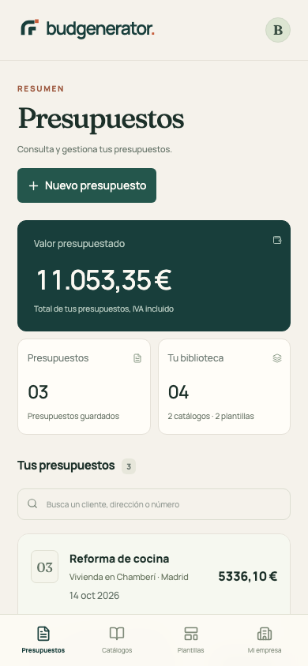
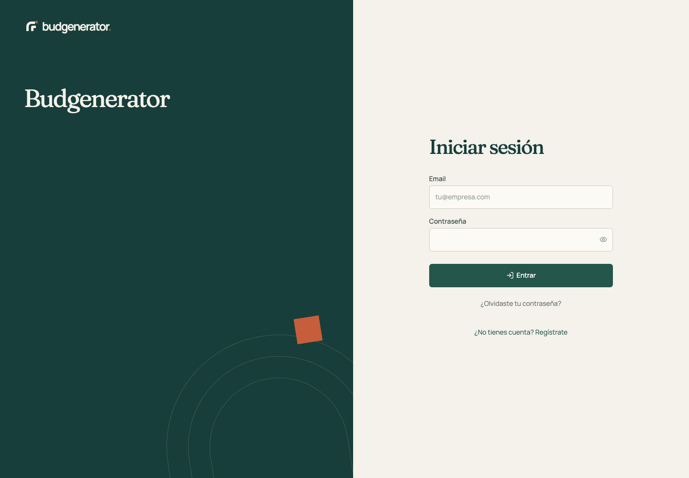
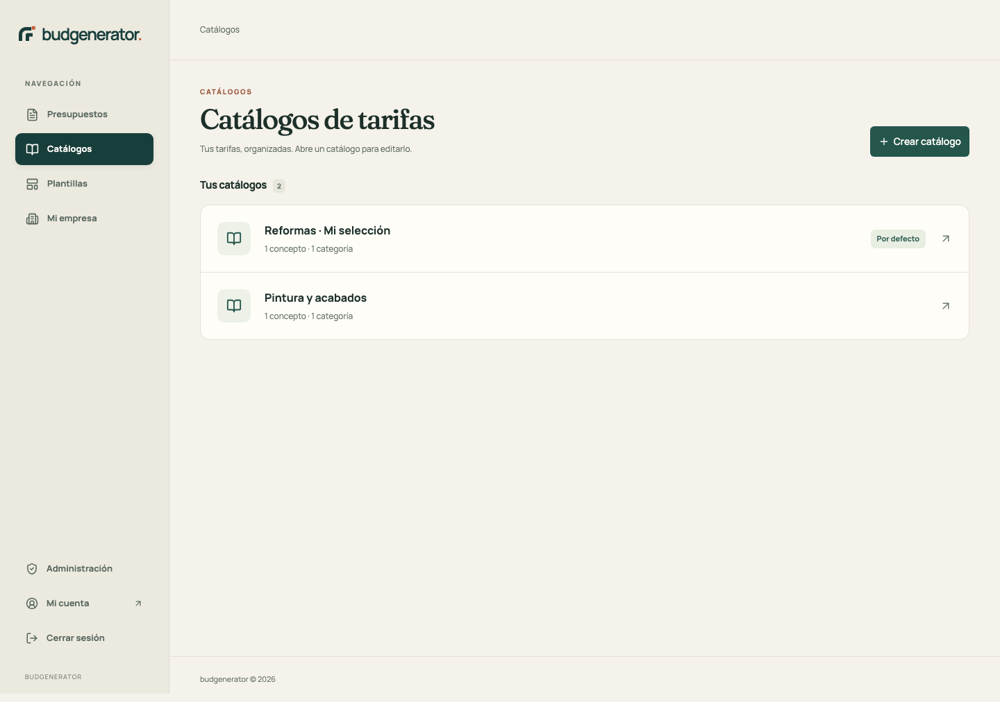

# budgenerator: identidad visual

Propuesta aplicada el 14 de octubre de 2026 y actualizada el 15 de octubre en `codex/stability-rebrand`.

## Diagnóstico visual

La interfaz anterior apoyaba casi toda su identidad en azul, tarjetas blancas, bordes grises e iconos de una librería. La estructura era funcional, pero la jerarquía se repetía entre páginas, no había una navegación persistente y la pantalla de acceso no contaba qué hacía distinto al producto. El presupuesto se sentía como un formulario genérico.

La oportunidad es acercar el producto a su contexto: profesionales que convierten medidas, materiales y horas de oficio en propuestas para clientes. La interfaz debe transmitir criterio, claridad y confianza, con cifras muy legibles y una personalidad que no compita con el trabajo del usuario.

## Marca propuesta y aplicada

**budgenerator.**

El nombre del producto sigue siendo **budgenerator**, tanto en la aplicación como en el PDF, la instalación PWA y los metadatos. La renovación aporta personalidad mediante el símbolo arquitectónico, los colores y la composición, sin cambiar el nombre del proyecto ni su URL.

La voz usa títulos e instrucciones directos: «Presupuestos», «No hay catálogos» y «Guardando…» describen información o acciones concretas. No se añaden estados ficticios de aceptación o facturación a los presupuestos.

## Paleta

| Color | HEX | Uso |
|---|---|---|
| Petróleo | `#183E3B` | Identidad, navegación activa, bloques destacados y PDF |
| Verde taller | `#24564C` | Acciones principales y enlaces |
| Cal | `#F5F2EB` | Fondo general, cómodo y cálido |
| Papel | `#FFFDF8` | Superficies y formularios |
| Terracota | `#C65D3B` | Firma de marca, puntos de atención y foco |
| Salvia | `#C9D7A4` | Contraste expresivo sobre petróleo |
| Tinta | `#1C3029` | Texto principal |

La paleta existente de utilidades se remapea a estos tokens, por lo que catálogos, plantillas, cuenta, perfil y administración comparten el mismo lenguaje. El color terracota aporta identidad sin sustituir los colores semánticos de error o éxito.

## Tipografía y logo

**Fraunces Variable** aporta una voz editorial a títulos y mensajes. **Manrope Variable** mantiene formularios, navegación y números compactos y legibles. Ambas fuentes se alojan con el proyecto, con subset latino y `font-display: swap`; no dependen de una petición a Google Fonts durante el arranque. Las licencias OFL acompañan a los paquetes instalados.

El símbolo usa dos trazos arquitectónicos que sugieren apoyo, hueco y estructura. El cuadrado terracota es el detalle distintivo que reaparece en la pantalla de acceso. El logo se construye como SVG para conservar nitidez y se exporta a los tamaños del manifest y Apple Touch. El logotipo ajusta su tamaño para mantener el nombre completo budgenerator en la barra lateral y la cabecera móvil.

Activos: `public/brand/icon.svg`, `public/brand/logo.svg`, iconos PNG de 192/512 px y previsualización social. Los SVG son los originales editables.

## Cambios de experiencia aplicados

- Navegación lateral persistente en escritorio y cuatro accesos inferiores en móvil: Presupuestos, Catálogos, Plantillas y Mi empresa. La sección activa permanece marcada dentro de sus editores.
- En escritorio, cuenta, administración y cierre de sesión se muestran sólo en el panel lateral. En móvil permanecen en el menú superior.
- Panel con valor presupuestado, número de documentos y biblioteca real del usuario.
- Búsqueda y paginación de la lista, con importes destacados y numeración de documentos.
- Login con composición editorial e ilustración geométrica. Textos reducidos al nombre del producto, el título de acceso y los controles necesarios.
- Editor, plantillas y catálogos con la nueva paleta, tipografía, formularios y feedback de guardado. La biblioteca de catálogos presenta una lista limpia; cada nombre abre una ruta de detalle para editar conceptos, nombre y catálogo por defecto. No hay enlace de vuelta a presupuestos en estas pantallas.
- Modales nativos con gestión de foco, Escape, bloqueo del fondo y errores visibles.
- PDF con jerarquía propia, color de marca, precios coherentes y continuación de páginas.
- Mensajes de conexión, recuperación y actualización PWA integrados en la identidad.
- Skeletons durante la carga de sesión, rutas, plantillas y presupuesto público, con errores y reintento diferenciados.

En móvil se reserva una tarjeta completa al importe total para evitar recortar cifras largas. La propuesta no utiliza fotografías decorativas ni depende de recursos externos para arrancar.

## Evidencia de la implementación

Capturas del build real con datos sintéticos y Firebase Emulator Suite; no son un mockup ni contienen presupuestos de producción.

[Acceso móvil simplificado](testing-evidence/budgenerator-login-mobile.png)

[Detalle de catálogo en móvil](testing-evidence/budgenerator-catalog-detail-mobile.png)

## Evolución posible

Para una siguiente iteración, priorizaría información real de estado del presupuesto —borrador, enviado, aceptado— y un seguimiento de proyectos antes de añadir más tarjetas de métricas. Después, una portada PDF configurable y preferencias de marca por empresa. Estos puntos son propuestas futuras: la versión aplicada no inventa esos datos.
