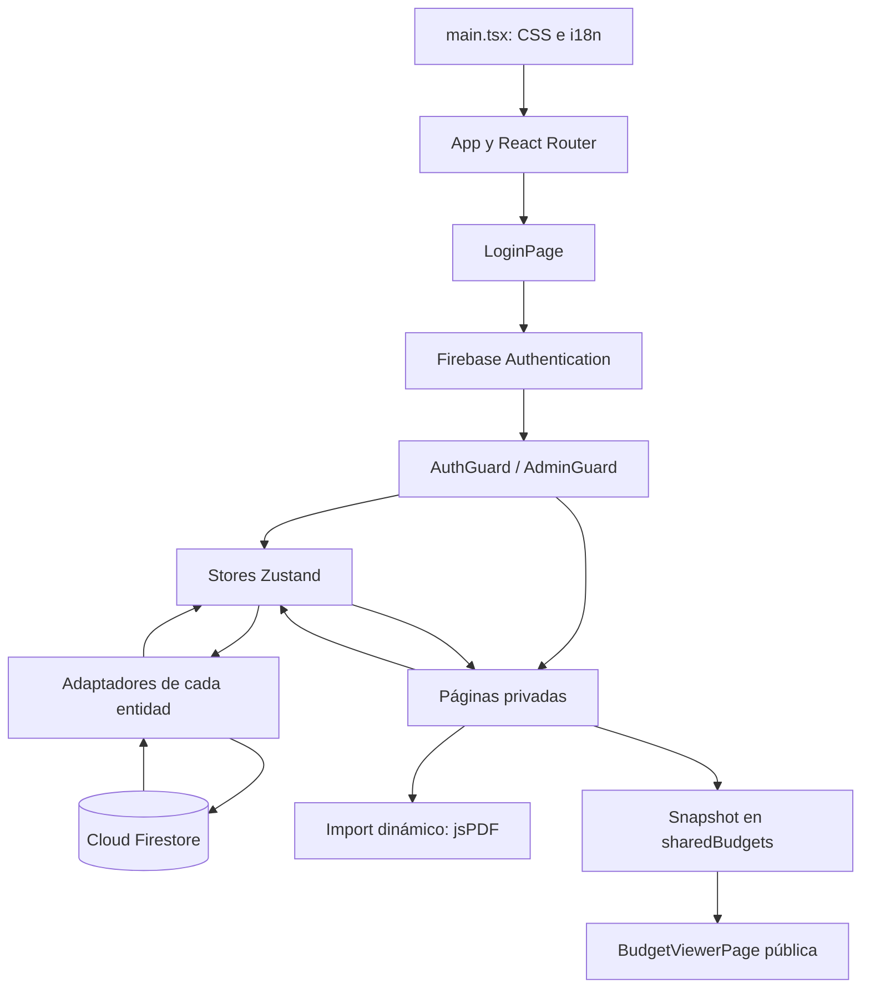

# Análisis técnico de Budgenerator

> Auditoría histórica del 4 de octubre de 2026 sobre `c065c02`. Las correcciones y la identidad actual se describen en `stability-and-release.md` y `design-proposal.md`. Algunos archivos de esta auditoría se han movido a `features/budget-editor` durante la entrega.

Fecha: 4 de octubre de 2026. Código revisado: `main`, commit `c065c02`. El repositorio estaba limpio al comenzar. Este informe describe la implementación actual y propone un orden para continuar el desarrollo.

## 1. Conclusión y alcance

Budgenerator es una aplicación web para preparar presupuestos de servicios y reformas. Es una SPA con React, TypeScript y Vite, organizada por entidades y páginas. Firebase Authentication gestiona la identidad, Firestore almacena los datos y Firebase Hosting sirve el resultado del build. Toda la lógica de edición, cálculo, planes y generación de PDF se ejecuta en el navegador. No hay servidor propio, Cloud Functions, pasarela de pago ni procesamiento de PDF en servidor en este checkout.

El producto ya permite trabajar con presupuestos, catálogos múltiples, plantillas, perfil de empresa, enlaces públicos y administración manual de planes premium. La estructura es suficientemente clara para ampliarlo. Antes de añadir funcionalidades, conviene corregir la autorización de Firestore, la publicación de datos privados y los problemas de persistencia y sesión descritos en la sección 12.

La revisión abarcó los 81 archivos de `src` —7.033 líneas—, configuración, reglas, recursos públicos, traducciones, documentación y cambios recientes del historial. Se ejecutaron build, lint, comprobación del arranque local, acceso autenticado y navegación en producción y pruebas locales de los stores con adaptadores simulados. La validación de datos de Firestore utilizó el SDK real sin enviar escrituras.

**Límites de la comprobación:** se inició sesión en producción con la cuenta administradora facilitada por el propietario, y se comprobaron pantallas y entradas directas a editores sin guardar contenido. No se crearon cuentas, no se enviaron correos, no se realizaron acciones de guardar presupuestos/catálogos/plantillas, no se cambiaron planes, no se desplegó y no se verificaron las reglas activas en Firebase. Los hallazgos de seguridad corresponden a las reglas versionadas; su impacto en producción depende de que esas reglas estén desplegadas. No se ejecutó el emulador de reglas. Las pruebas de stores demuestran su comportamiento local; la navegación autenticada verifica acceso y carga, pero faltan pruebas de extremo a extremo de escritura con Firebase. Los loaders de la aplicación pueden ejecutar las migraciones descritas en la sección 5.

La referencia `RTK.md` facilitada al inicio no se encontró en el repositorio, en sus directorios superiores ni en el directorio de configuración de Codex revisado. También se consultó `.github/AGENTS.md`, que contiene convenciones del proyecto y varias referencias antiguas.

## 2. Stack tecnológico real

Las versiones declaradas son rangos de `package.json`; las instaladas se comprobaron en `node_modules`. El lockfile es `pnpm-lock.yaml`.

| Pieza | Declarada | Instalada durante la revisión | Responsabilidad |
|---|---|---|---|
| React / React DOM | `^19.2.4` | 19.2.5 | Componentes, hooks, renderizado con StrictMode |
| TypeScript | `~6.0.2` | 6.0.3 | Tipado y comprobación previa al build |
| Vite | `^8.0.4` | 8.0.8 | Servidor local y bundle de producción |
| Plugin React para Vite | `^6.0.1` | 6.0.1 | Transformación React y desarrollo |
| Tailwind CSS / plugin Vite | `^4.2.2` | 4.2.2 | Estilos definidos mediante utilidades y CSS |
| Zustand | `^5.0.12` | 5.0.12 | Seis stores en memoria |
| Firebase SDK | `^12.12.0` | 12.12.0 | Authentication y Firestore |
| React Router DOM | `^7.14.1` | 7.14.1 | Rutas SPA, guards, navegación y bloqueo de borradores |
| i18next | `^26.0.8` | 26.0.8 | Traducciones e interpolación |
| i18next HTTP backend | `^3.0.6` | 3.0.6 | Carga de JSON de traducción por HTTP |
| jsPDF | `^4.2.1` | 4.2.1 | Generación directa del PDF en cliente |
| Lucide React | `^1.8.0` | 1.8.0 | Iconos |
| clsx / tailwind-merge | `^2.1.1` / `^3.5.0` | 2.1.1 / 3.5.0 | Composición de clases con `cn()` |
| nanoid | `^5.1.9` | 5.1.9 | Dependencia declarada sin uso en `src` |
| ESLint | `^9.39.4` | 9.39.4 | Reglas JS, TypeScript, hooks y React Refresh |
| Firebase CLI | `^15.15.0` | 15.15.0 | Herramientas de Firebase |

Entorno comprobado: Node 24.14.0 y pnpm 10.33.0. El paquete Vite instalado declara Node `^20.19.0 || >=22.12.0`. El proyecto no fija `engines` ni `packageManager`, por lo que conviene documentar y fijar el entorno de desarrollo.

TypeScript activa `strict`, `noUncheckedIndexedAccess`, `noUnusedLocals`, `noUnusedParameters` y `noFallthroughCasesInSwitch`. Usa resolución `bundler`, objetivo ES2023 y alias `@/*` hacia `src/*`. Vite reproduce ese alias y escucha en el puerto 3000.

Referencias: [package.json](</Users/srebuelta/- Personal/Proyectos/renovation-budget-generator/package.json>), [vite.config.ts](</Users/srebuelta/- Personal/Proyectos/renovation-budget-generator/vite.config.ts>), [tsconfig.app.json](</Users/srebuelta/- Personal/Proyectos/renovation-budget-generator/tsconfig.app.json>), [eslint.config.js](</Users/srebuelta/- Personal/Proyectos/renovation-budget-generator/eslint.config.js>).

## 3. Arquitectura y responsabilidades

La estructura sigue una adaptación de Feature-Sliced Design:

```text
src/
├── app/                 Arranque, router, guards y pantalla de error
├── entities/
│   ├── auth/            Firebase Auth y estado de sesión
│   ├── budget/          Presupuestos, borradores, cálculos y persistencia
│   ├── catalog/         Catálogos, tarifas, bases y migración del modelo anterior
│   ├── template/        Plantillas de presupuestos
│   ├── profile/         Datos de empresa y logo
│   └── user/            Cuenta, límites, premium y administración
├── pages/               Pantallas asociadas a rutas y componentes de página
└── shared/
    ├── firebase/        Inicialización de Firebase
    ├── i18n/            Configuración de traducciones
    ├── lib/             IDs, moneda, clases y PDF
    ├── types/           Interfaces del dominio
    └── ui/              Componentes reutilizables
```

Cada entidad separa `model/store.ts` de `api/firestore.ts` o `api/firebase.ts`. Los `index.ts` ofrecen su API pública. Las páginas coordinan stores y renderizan la UI; la lógica de cálculo y buena parte de las mutaciones reside en el store de presupuestos.



La dirección prevista de dependencias es `app → pages → entities → shared`. Hay excepciones actuales:

- `shared/ui/BudgetLimitReached.tsx` importa `FREE_BUDGET_LIMIT` desde `entities/user`, una dependencia hacia una capa superior.
- `pages/template-detail` importa directamente tres componentes de `pages/budget-detail`.
- `entities/budget` depende de `entities/user` para incrementar el contador después de crear un presupuesto.

No impiden compilar, pero orientan los próximos refactors: mover el editor reutilizable a una capa adecuada y coordinar la creación/cuota desde un caso de uso común. La arquitectura no tiene una capa `features` o `widgets` actualmente.

## 4. Arranque, sesión y rutas

### Arranque

`main.tsx` importa CSS e inicializa i18next. Espera `i18nReady` antes de montar React con `StrictMode`. `App` monta `RouterProvider`. Se registra `/sw.js` si el navegador soporta service workers.

Los componentes `LoginPage`, `AuthGuard` y `AdminGuard` suscriben `onAuthStateChanged` mediante `useAuthStore.init()` y liberan la suscripción en el cleanup. No hay un único proveedor de sesión en el shell.

Cuando `AuthGuard` detecta un usuario, inyecta getters de UID en los stores y lanza las cargas de presupuestos, catálogos, perfil, plantillas y cuenta. No espera a que finalicen para renderizar las páginas. El flag de carga del guard representa Firebase Auth; cada página trata después la carga de sus datos.

`AdminGuard` comprueba `userData.accountData.isAdmin` y carga la cuenta si el store no está marcado como cargado. La decisión de acceso de la UI debe apoyarse en reglas seguras en Firestore.

Referencias: [src/main.tsx](</Users/srebuelta/- Personal/Proyectos/renovation-budget-generator/src/main.tsx>), [src/app/AuthGuard.tsx](</Users/srebuelta/- Personal/Proyectos/renovation-budget-generator/src/app/AuthGuard.tsx>), [src/app/AdminGuard.tsx](</Users/srebuelta/- Personal/Proyectos/renovation-budget-generator/src/app/AdminGuard.tsx>).

### Rutas actuales

| Ruta | Pantalla / comportamiento | Acceso |
|---|---|---|
| `/` | Redirección a `/budgets` | Redirección |
| `/login` | Login, registro y recuperación de contraseña | Pública |
| `/shared/:token` | Vista del snapshot y descarga de PDF | Pública |
| `/budgets` | Lista y creación de presupuestos | Autenticado |
| `/budget/new` | Nuevo presupuesto en memoria | Autenticado, comprobación de cuota en UI |
| `/budget/:budgetId` | Editor de presupuesto guardado | Autenticado |
| `/catalogs` | Gestión de catálogos y tarifas | Autenticado |
| `/templates` | Lista y gestión de plantillas | Autenticado |
| `/templates/new` | Creación de plantilla | Autenticado |
| `/templates/:templateId` | Edición de plantilla | Autenticado |
| `/profile` | Empresa y logo | Autenticado |
| `/account` | Estado del plan | Autenticado |
| `/account/password` | Cambio de contraseña con reautenticación | Autenticado |
| `/admin` | Usuarios, cambio de plan y vencimiento | Admin en UI |
| Cualquier otra | Redirección a `/` | Según destino |

Las rutas utilizan `errorElement` con `ErrorPage`, salvo las redirecciones simples. No hay rutas lazy: las páginas se importan de forma estática. No hay loaders de React Router; las cargas parten de los efectos y stores.

Referencia: [src/app/router.tsx](</Users/srebuelta/- Personal/Proyectos/renovation-budget-generator/src/app/router.tsx>).

## 5. Dominio y modelo de Firestore

### Modelo del dominio

| Tipo | Contenido y significado |
|---|---|
| `Budget` | ID, información de cliente, partidas, catálogo opcional, ajuste opcional, IVA opcional y fecha de creación |
| `BudgetInfo` | Nombre del cliente, dirección, fecha y número de presupuesto |
| `WorkItem` | Partida con ID, nombre y array de tareas |
| `BudgetTask` | Concepto con descripción, cantidad, unidad, precio de venta y coste interno |
| `Tariff` | Tarifa con descripción, unidad, PVP (`basePrice`), coste y categoría |
| `TariffCatalog` | Catálogo con nombre, tarifas embebidas, base de origen opcional y fechas |
| `BudgetTemplate` | Nombre, partidas, catálogo opcional, ajuste opcional y fecha; no contiene IVA |
| `CompanyProfile` | Empresa, CIF, dirección, teléfono, email y logo opcional como data URL |
| `UserData` | UID, email, plan, admin, vencimiento premium opcional, contador acumulado y fecha |
| `SharedBudget` | Copia del presupuesto, copia de empresa, IVA y momento de publicación |

Unidades: `m2`, `m3`, `ml`, `unit`, `hour`. Los IDs nuevos se generan con `crypto.randomUUID()` a través de `generateId()`, salvo el token público que utiliza `crypto.randomUUID()` directamente. Las fechas se almacenan como strings ISO, no como `Timestamp` de Firestore.

Referencia: [src/shared/types/index.ts](</Users/srebuelta/- Personal/Proyectos/renovation-budget-generator/src/shared/types/index.ts>).

### Esquema actual

```text
users/{uid}                              UserData
├── budgets/{budgetId}                   Budget con partidas/tareas embebidas
├── tariffCatalogs/{catalogId}            TariffCatalog con tarifas embebidas
├── templates/{templateId}                BudgetTemplate
├── profile/data                         CompanyProfile
└── settings/tariffCatalog                { activeCatalogId }

sharedBudgets/{token}                    SharedBudget, lectura pública según reglas locales
```

Un presupuesto y un catálogo se guardan como documentos completos con arrays internos. Esto reduce la complejidad de consultas, pero hace que las ediciones escriban arrays/documentos enteros y amplía el riesgo de sobrescrituras concurrentes. No hay suscripciones `onSnapshot`, paginación, control de versión de documento ni validación de esquema en tiempo de ejecución. Los adaptadores convierten respuestas mediante casts TypeScript.

### Compatibilidad y migraciones

- Los presupuestos aceptan `sections` o `workItems`; las tareas aceptan `rows`, `concepts` o `tasks`. Al guardar se escribe el formato actual.
- El perfil antiguo en `settings/profile` se copia a `profile/data` y se elimina el documento antiguo.
- La cuenta antigua en `settings/userData` se copia al documento raíz del usuario y se elimina el antiguo.
- Si no hay catálogos nuevos y existen documentos en `tariffs`, se crea «Mi catálogo», se selecciona y se eliminan las tarifas antiguas.

Estas migraciones ocurren al cargar datos y algunas incluyen escrituras y borrados. No son transacciones completas entre todos los pasos ni tienen un campo de versión de esquema. Cargas duplicadas o fallos intermedios deben probarse expresamente antes de cambiarlas.

Referencias: [src/entities/budget/api/firestore.ts](</Users/srebuelta/- Personal/Proyectos/renovation-budget-generator/src/entities/budget/api/firestore.ts>), [src/entities/catalog/model/store.ts:82](</Users/srebuelta/- Personal/Proyectos/renovation-budget-generator/src/entities/catalog/model/store.ts:82>), [src/entities/profile/api/firestore.ts](</Users/srebuelta/- Personal/Proyectos/renovation-budget-generator/src/entities/profile/api/firestore.ts>), [src/entities/user/api/firestore.ts](</Users/srebuelta/- Personal/Proyectos/renovation-budget-generator/src/entities/user/api/firestore.ts>).

## 6. Estado, caché y persistencia

| Store | Estado principal | Lectura | Escritura |
|---|---|---|---|
| Auth | `user`, `loading`, `error` | Listener de Firebase Auth | APIs de autenticación |
| Budget | `budgets`, `activeBudgetId`, `draftBudget`, `loaded` | `getDocs`, recarga sin guarda de caché | Borrador: guardado explícito; existente: debounce de 1 s |
| Catalog | `catalogs`, `activeCatalogId`, `tariffs`, `loaded` | Omite cargas si `loaded` es true | Espera escritura y después cambia estado |
| Template | `templates`, `loaded` | `getDocs`, sin guarda de caché | Guardado/borrado explícito, después actualiza estado |
| Profile | `profile`, `loaded` | Lectura y posible migración | Texto local + botón guardar; logo se guarda al subir/quitar |
| User | Cuenta, usuarios admin y flags de carga | Lectura y posible creación/migración | Contador y cambios de plan |

No hay middleware `persist` de Zustand. `localStorage` guarda preferencias de colapsado, no presupuestos o catálogos. No se configura persistencia duradera offline de Firestore.

`tariffs` es una proyección duplicada del catálogo activo. Cada operación del store de catálogo mantiene ambos estados. El presupuesto puede elegir un catálogo distinto del activo global: los selectores resuelven `budget.catalogId ?? activeCatalogId`.

La estrategia real no garantiza actualización inmediata entre dispositivos: las lecturas son puntuales y el catálogo queda cacheado en memoria. Cambios remotos pueden permanecer invisibles hasta una recarga. Es una diferencia respecto a algunas afirmaciones de la documentación antigua.

### Borrador y presupuesto activo

`getActive()` y `useActiveBudget()` priorizan `draftBudget`; si no existe, buscan `activeBudgetId` en `budgets`. `updateActive()` permite reutilizar las mismas mutaciones para ambos modos.

Un nuevo presupuesto empieza con ID y `createdAt` vacíos, fecha UTC y número sugerido a partir del mayor `parseInt(budgetNumber)` existente. Al guardar se asignan UUID y fecha, se filtran conceptos incompletos, se escribe el presupuesto y se incrementa el contador.

Un concepto se considera completo si tiene descripción no vacía, cantidad mayor que cero y precio mayor que cero. El coste puede ser cero. Las tareas incompletas permanecen localmente durante la edición de presupuestos existentes, pero se omiten de lo persistido; después de recargar desaparecen. Esta regla también impide conservar líneas gratuitas al guardar un presupuesto.

Referencia: [src/entities/budget/model/store.ts](</Users/srebuelta/- Personal/Proyectos/renovation-budget-generator/src/entities/budget/model/store.ts>).

## 7. Flujos funcionales

### Presupuestos

La lista permite abrir presupuestos y comenzar uno nuevo, en blanco o desde una plantilla. El editor permite datos de cliente, partidas por categoría o nombre libre, tareas manuales, aplicación de tarifas, cambio de catálogo, IVA, descuento/recargo, publicación y PDF.

Aplicar una tarifa copia descripción, unidad, PVP y coste dentro de la tarea. No establece una referencia viva a la tarifa: cambiar después el catálogo no actualiza tareas existentes. Esto conserva los precios históricos del presupuesto.

El borrador tiene bloqueo de navegación interna y aviso de cierre/recarga cuando contiene cliente, dirección o partidas. Se conserva solo en memoria. Un presupuesto existente se modifica de forma optimista y se guarda automáticamente.

La lista invierte el array recibido; no consulta ni ordena expresamente por `createdAt`. La numeración automática tampoco reserva números de forma atómica entre dispositivos. El icono `GripVertical` es decorativo: no hay reordenación mediante arrastre implementada.

### Catálogos

Hay **21 catálogos base**, incluido «En blanco», con **211 tarifas sumadas entre todas las bases**. Las bases cubren reformas, albañilería, pintura, electricidad, fontanería, climatización, energía solar, carpinterías, limpieza y otros oficios. Cada creación clona las tarifas con nuevos IDs y genera un nombre único con sufijo numérico.

El archivo antiguo `catalog.ts` conserva 28 categorías canónicas y 121 tarifas por defecto. Las categorías se usan en la UI; el array `DEFAULT_TARIFFS` no es el mecanismo actual de creación de catálogos.

Se puede seleccionar, renombrar y borrar catálogos; añadir, modificar y borrar tarifas; buscar con debounce de 200 ms y filtrar por categoría. Los cambios de tarifas escriben el array completo del catálogo. Borrar un catálogo no borra ni modifica los conceptos ya copiados en presupuestos, pero puede dejar `catalogId` de presupuestos o plantillas apuntando a un catálogo inexistente.

Referencias: [src/entities/catalog/model/baseCatalogs.ts](</Users/srebuelta/- Personal/Proyectos/renovation-budget-generator/src/entities/catalog/model/baseCatalogs.ts>), [src/entities/catalog/model/catalog.ts](</Users/srebuelta/- Personal/Proyectos/renovation-budget-generator/src/entities/catalog/model/catalog.ts>), [src/pages/catalogs/CatalogsPage.tsx](</Users/srebuelta/- Personal/Proyectos/renovation-budget-generator/src/pages/catalogs/CatalogsPage.tsx>).

### Plantillas

Se pueden guardar a partir de un presupuesto o crear desde `/templates/new`, editar y borrar. Al usarlas para crear un presupuesto se regeneran IDs de partidas y tareas y se añade nueva información de cliente.

El editor de plantillas reutiliza `draftBudget`, `BudgetEditor`, `AddWorkItemButton` y `BudgetSummary`. La plantilla conserva partidas, ajuste y catálogo, pero **no conserva IVA**, aunque la pantalla permite modificarlo. El editor de plantillas descarta su draft al desmontarse y no implementa el bloqueo de cambios sin guardar que sí tiene el editor de presupuestos.

Referencias: [src/pages/template-detail/TemplateDetailPage.tsx](</Users/srebuelta/- Personal/Proyectos/renovation-budget-generator/src/pages/template-detail/TemplateDetailPage.tsx>), [src/pages/budget-detail/components/SaveTemplateButton.tsx](</Users/srebuelta/- Personal/Proyectos/renovation-budget-generator/src/pages/budget-detail/components/SaveTemplateButton.tsx>), [src/entities/template/api/firestore.ts](</Users/srebuelta/- Personal/Proyectos/renovation-budget-generator/src/entities/template/api/firestore.ts>).

### Empresa, cuenta y administración

El perfil se edita en memoria y se guarda mediante botón. El email se fuerza al de autenticación y es de solo lectura en la UI. El logo admite imágenes con límite de 500 KiB de archivo y se convierte a base64; no se usa Firebase Storage.

El plan gratuito permite **tres presupuestos creados acumulados**, no tres presupuestos simultáneos. Borrar uno no devuelve cuota. Premium permite crear mientras no haya vencido; sin fecha de vencimiento se considera vigente. La evaluación del vencimiento depende del reloj del cliente.

La cuenta de admin se inicializa en el cliente comparando el email con `CONTACT_EMAIL`. El panel permite cambiar planes y fechas; al activar premium asigna aproximadamente un año. La contratación se realiza por contacto de email, sin checkout ni sistema de cobros en el código.

El cambio de contraseña reautentica con la contraseña actual antes de actualizarla. El registro y cambio de contraseña exigen en UI seis caracteres, mayúscula, minúscula y número; no se puede deducir del repositorio la política configurada en Firebase. No hay flujo de verificación de email implementado.

Referencias: [src/entities/user/model/store.ts](</Users/srebuelta/- Personal/Proyectos/renovation-budget-generator/src/entities/user/model/store.ts>), [src/pages/admin/AdminPage.tsx](</Users/srebuelta/- Personal/Proyectos/renovation-budget-generator/src/pages/admin/AdminPage.tsx>), [src/entities/auth/api/firebase.ts](</Users/srebuelta/- Personal/Proyectos/renovation-budget-generator/src/entities/auth/api/firebase.ts>), [src/pages/profile/ProfilePage.tsx](</Users/srebuelta/- Personal/Proyectos/renovation-budget-generator/src/pages/profile/ProfilePage.tsx>).

## 8. Cálculos y precisión

Para cada tarea: `importe base = quantity × price`.

Para el presupuesto:

```text
S = suma de todos los importes base
m = adjustment.multiplier, o 1
v = ivaRate, o 0,10
subtotal = S × m
IVA = subtotal × v
total = subtotal + IVA
coste = suma de quantity × cost
margen monetario = subtotal − coste
margen porcentual = margen monetario / subtotal × 100
```

El margen se calcula sobre ingresos antes de IVA. La cantidad monetaria no se redondea de forma centralizada a céntimos antes de sumar; se formatea al presentar. Es necesario decidir una política única de redondeo para editor, PDF y vista pública.

- Con **recargo** (`m > 1`), los importes de cada tarea y los subtotales de partida incorporan el multiplicador. El PDF y la vista pública no muestran una línea separada de recargo.
- Con **descuento** (`m < 1`), las líneas muestran importes base y el descuento se aplica en el resumen.
- El precio unitario mostrado sigue siendo `task.price` incluso con recargo. Por ejemplo, `2 × 50 €` puede presentarse junto a `110 €`. Conviene ajustar también el PVP visible o explicar la diferencia.

La prueba local con subtotal base 100 €, recargo del 10 % e IVA del 21 % dio subtotal 110 €, IVA 23,10 € y total 133,10 €, coherentes con las fórmulas. Internamente aparecieron valores de coma flotante como `110.00000000000001`.

Actualmente editor y catálogo usan `parseInt` e inputs con paso entero para cantidades, PVP y costes. Una cantidad de 2,5 o un precio de 10,75 no se conservan correctamente al editar. La base de mudanzas ya contiene un coste decimal de 1,5, por lo que existe una discrepancia con los propios datos iniciales.

Referencias: [src/entities/budget/model/store.ts:269](</Users/srebuelta/- Personal/Proyectos/renovation-budget-generator/src/entities/budget/model/store.ts:269>), [src/pages/budget-detail/components/BudgetEditor.tsx:49](</Users/srebuelta/- Personal/Proyectos/renovation-budget-generator/src/pages/budget-detail/components/BudgetEditor.tsx:49>), [src/pages/budget-detail/components/BudgetSummary.tsx](</Users/srebuelta/- Personal/Proyectos/renovation-budget-generator/src/pages/budget-detail/components/BudgetSummary.tsx>), [src/shared/lib/pdf.ts](</Users/srebuelta/- Personal/Proyectos/renovation-budget-generator/src/shared/lib/pdf.ts>).

## 9. PDF y publicación

### PDF

La exportación actual importa dinámicamente `shared/lib/pdf.ts` y utiliza jsPDF directamente, con posiciones en milímetros y **A4 vertical**. El CSS de impresión del navegador mantiene un layout A4 horizontal independiente. El botón de exportación no llama a `window.print()`.

Se abre una ventana durante el gesto del usuario antes del import para evitar bloqueos de popups en iOS Safari. Después se genera un Blob y se navega la ventana al PDF; si no hay ventana disponible, se descarga con `doc.save()`.

El documento incluye empresa/logo cuando hay nombre de empresa, cliente, partidas, conceptos, subtotal, descuento si corresponde, IVA y total. No incluye el coste interno ni el margen de forma visible. Los textos del PDF están escritos directamente en español y no usan `t()`.

Aspectos pendientes:

- `ExportPdfButton` llama a la función asíncrona sin `await`: el indicador termina pronto y un rechazo posterior no entra en su `catch`.
- Las descripciones y datos largos se dibujan sin wrapping ni cálculo de altura de texto.
- Una partida que cruza páginas conserva `cardStartY` de la página anterior para el borde final; faltan bordes/cabeceras de continuación correctos.
- El ancho del logo solo depende de su proporción y una altura fija, sin máximo horizontal.
- Se aceptan logos SVG/WebP en perfil, pero la generación pasa formato `JPEG` a `addImage`; conviene probar cada formato admitido.
- No se libera expresamente el Object URL creado para la vista del PDF.

Estas cuestiones de layout proceden de inspección de código; no se generaron ni inspeccionaron visualmente PDFs en esta revisión.

Referencias: [src/shared/ui/ExportPdfButton.tsx:20](</Users/srebuelta/- Personal/Proyectos/renovation-budget-generator/src/shared/ui/ExportPdfButton.tsx:20>), [src/shared/lib/pdf.ts:38](</Users/srebuelta/- Personal/Proyectos/renovation-budget-generator/src/shared/lib/pdf.ts:38>), [src/index.css](</Users/srebuelta/- Personal/Proyectos/renovation-budget-generator/src/index.css>).

### Enlaces públicos

Cada publicación crea un UUID y guarda un snapshot en `sharedBudgets/{token}`. El botón reutiliza la URL durante su montaje: editar después el presupuesto no actualiza ese snapshot. Se usa Web Share API si existe y, como alternativa, el portapapeles. La vista pública recupera el snapshot y permite exportarlo a PDF.

No hay propietario explícito, vencimiento o revocación del snapshot. Las reglas locales prohíben actualización y borrado de `sharedBudgets` para todos los clientes. Los errores de compartir, salvo cancelaciones, se absorben sin mostrar una explicación.

La publicación copia el objeto `Budget` completo, incluidos los costes internos y el ajuste. La UI pública los oculta parcialmente, pero siguen en el documento accesible. Las reglas permiten además listar la colección pública completa. Ver los hallazgos críticos de la sección 12.

Referencias: [src/entities/budget/api/firestore.ts:109](</Users/srebuelta/- Personal/Proyectos/renovation-budget-generator/src/entities/budget/api/firestore.ts:109>), [src/pages/budget-detail/components/ShareButton.tsx](</Users/srebuelta/- Personal/Proyectos/renovation-budget-generator/src/pages/budget-detail/components/ShareButton.tsx>), [src/pages/budget-viewer/BudgetViewerPage.tsx](</Users/srebuelta/- Personal/Proyectos/renovation-budget-generator/src/pages/budget-viewer/BudgetViewerPage.tsx>), [firestore.rules:20](</Users/srebuelta/- Personal/Proyectos/renovation-budget-generator/firestore.rules:20>).

## 10. UI, internacionalización, rendimiento y PWA

La UI usa Tailwind 4 con plugin Vite, paleta azul personalizada en `index.css`, layouts móviles y de escritorio, cards, modales y skeletons. `EditableRow` centraliza filas editables para presupuesto y catálogo; renderiza dos variantes en el DOM, controladas por CSS. Varios botones e inputs compartidos tienen altura mínima de 44 px, pero esa garantía no se aplica a todos los controles hechos a mano.

Hay memoización en las tareas y selectores, agrupaciones mediante `useMemo` y debounce de búsqueda. `CatalogSelector` se suscribe al presupuesto completo mediante `useActiveBudget()`, por lo que puede renderizarse en cada edición aunque use `memo`. Conviene medir antes de ampliar la memoización o introducir virtualización.

i18next carga `/locales/es/translation.json` al inicio; hay 246 entradas de texto y español como idioma y fallback. El análisis de llamadas literales a `t()` no encontró claves ausentes. Esto no verifica exhaustivamente las interpolaciones o textos dinámicos. Persisten textos sin extraer, especialmente en PDF, fechas relativas de administración, algunos labels y «Todas» en catálogos. No existe selector de idioma ni integración reactiva con `react-i18next`.

Los modales permiten Escape y click en backdrop, pero no implementan `role="dialog"`, `aria-modal`, confinamiento/restauración de foco o control del scroll del fondo. Varias acciones son iconos sin nombre accesible y varias tarjetas usan `div` clicable. La accesibilidad requiere una revisión específica con teclado y lector de pantalla.

La PWA tiene manifest, iconos y service worker. El worker intenta red y usa `caches.match` ante fallo, pero nunca escribe en caché ni precarga recursos. Por tanto, no implementa un modo offline funcional por sí mismo. Tampoco hay flujo visible para actualización del service worker.

El build actual produjo:

| Archivo / grupo | Tamaño minificado | Gzip |
|---|---|---|
| JS principal | 853,08 kB | 252,21 kB |
| Chunk de PDF | 403,32 kB | 131,07 kB |
| CSS principal | 36,41 kB | 7,51 kB |

Hay otros chunks de dependencias de jsPDF, incluidos html2canvas y DOMPurify, aunque el generador actual no renderiza el DOM con ellos. Vite emitió aviso por superar 500 kB en un chunk. La carga inicial puede mejorarse separando rutas secundarias; el PDF ya dispone de import dinámico.

Referencias: [src/shared/ui/EditableRow.tsx](</Users/srebuelta/- Personal/Proyectos/renovation-budget-generator/src/shared/ui/EditableRow.tsx>), [src/shared/ui/Modal.tsx](</Users/srebuelta/- Personal/Proyectos/renovation-budget-generator/src/shared/ui/Modal.tsx>), [src/shared/i18n/index.ts](</Users/srebuelta/- Personal/Proyectos/renovation-budget-generator/src/shared/i18n/index.ts>), [public/locales/es/translation.json](</Users/srebuelta/- Personal/Proyectos/renovation-budget-generator/public/locales/es/translation.json>), [public/sw.js](</Users/srebuelta/- Personal/Proyectos/renovation-budget-generator/public/sw.js>), [public/manifest.json](</Users/srebuelta/- Personal/Proyectos/renovation-budget-generator/public/manifest.json>).

## 11. Ejecución, configuración y validación

### Comandos del proyecto

```bash
pnpm install --frozen-lockfile
pnpm dev
pnpm build
pnpm lint
pnpm preview
```

`pnpm build` ejecuta `tsc -b && vite build`. `pnpm firebase:deploy` ejecuta build y `pnpm dlx firebase-tools deploy --only hosting`. El README indicaba originalmente `pnpm deploy`; durante esta revisión se corrigió a `pnpm firebase:deploy` y se añadió una guía de pruebas. El despliegue de hosting no publica cambios de reglas; estos requieren una operación específica. El uso de `dlx firebase-tools` tampoco fija expresamente la versión al CLI local del lockfile.

La configuración utiliza seis variables en `.env`, ignorado por Git:

```text
VITE_FIREBASE_API_KEY
VITE_FIREBASE_AUTH_DOMAIN
VITE_FIREBASE_PROJECT_ID
VITE_FIREBASE_STORAGE_BUCKET
VITE_FIREBASE_MESSAGING_SENDER_ID
VITE_FIREBASE_APP_ID
```

No se encontró `.env.example` ni validación temprana de variables. El proyecto por defecto del CLI en `.firebaserc` es `budgenerator`. No hay configuración de emuladores ni separación local explícita entre desarrollo y producción.

Firebase Hosting sirve `dist`, reescribe las rutas a `index.html` y da un año de caché inmutable a `/assets/**`. Las traducciones JSON no están dentro de esos assets con hash. Las meta etiquetas para compartir son estáticas; cambiar `document.title` en el visor público no genera metadata propia para bots de previsualización.

### Resultados observados

| Comprobación | Resultado |
|---|---|
| Build de producción y TypeScript | Pasa; aviso de bundle grande |
| ESLint | Falla con dos errores `react-hooks/set-state-in-effect` |
| Localizaciones de los errores | `CatalogsPage.tsx`, líneas 61 y 71 |
| Arranque local | Login renderizado correctamente |
| Acceso anónimo a `/budgets` | Redirección a `/login` confirmada |
| Consola del navegador en esa comprobación | Sin errores o warnings capturados |
| Claves literales de traducción | Ninguna ausente detectada |
| Tests del repositorio | No hay suite ni script de tests |
| CI | No se encontraron workflows |
| Navegación autenticada en producción | Login admin, presupuestos, catálogos, plantillas, perfil, cuenta, panel y cierre de sesión comprobados |
| Carga directa de editores en producción | `/templates/new` queda en skeleton y `/budget/new` en blanco |
| Escrituras completas, reglas activas, PDFs visuales | No verificadas |

### Reproducciones locales adicionales

Se transpilaron los stores reales con TypeScript, se usó Zustand real y se sustituyeron únicamente adaptadores/temporizadores por dobles locales. Para validar la publicación se usó `WriteBatch.set()` del SDK real sobre un proyecto demo, sin ejecutar `commit()`.

| Caso | Resultado reproducido |
|---|---|
| Editar A y después B antes de vencer el debounce | Solo se guarda B |
| Editar A, borrarlo y ejecutar el temporizador pendiente | Se llama a guardar A después de borrarlo |
| Dos `saveDraft()` simultáneos | Dos IDs y dos guardados del mismo borrador |
| Recargar presupuestos con draft activo | El draft pasa a `null` |
| Cargar catálogos de A y después de B | No se consulta B; permanece el catálogo de A |
| Cambiar descripción y coste del catálogo antes de resolver las escrituras | La segunda edición restaura la descripción antigua |
| Compartir presupuesto leído con campos opcionales ausentes | Error local por valor `undefined` en `budget.catalogId` |
| Compartir presupuesto sin campos `undefined` | El payload incluye el coste interno de sus tareas |
| Cálculo 100 € + 10 % recargo + 21 % IVA | Total 133,10 € |

Referencias: [src/pages/catalogs/CatalogsPage.tsx:61](</Users/srebuelta/- Personal/Proyectos/renovation-budget-generator/src/pages/catalogs/CatalogsPage.tsx:61>), [firebase.json](</Users/srebuelta/- Personal/Proyectos/renovation-budget-generator/firebase.json>), [src/shared/firebase/config.ts](</Users/srebuelta/- Personal/Proyectos/renovation-budget-generator/src/shared/firebase/config.ts>), [package.json](</Users/srebuelta/- Personal/Proyectos/renovation-budget-generator/package.json>).

## 12. Hallazgos y prioridades

### Crítico: permisos de administrador y plan controlados por el propietario

`isAdmin()` lee `users/{request.auth.uid}.accountData.isAdmin`. Las reglas permiten a cualquier usuario escribir su propio documento completo y subdocumentos. Un usuario puede modificar su `isAdmin`; en peticiones posteriores esa bandera le concede acceso a los datos de otros usuarios. También puede cambiar plan, vencimiento y contador. El guard de React y la comparación del email en el cliente no corrigen esta autorización.

Hay dos matches relevantes. En versión 2, el wildcard recursivo también puede coincidir con el documento raíz: endurecer solo el primer match dejaría vigente el permiso del segundo. Los permisos de matches coincidentes se combinan por concesión. Esta interpretación se apoya en la [documentación oficial de estructura de reglas](https://firebase.google.com/docs/firestore/security/rules-structure).

**Corrección propuesta:** retirar escrituras del usuario sobre campos de privilegio, revisar todos los matches y establecer roles mediante un mecanismo de confianza —claims asignadas por Admin SDK o documento de rol protegido—. Crear las cuentas con valores seguros y separar las operaciones administrativas. Probar aislamiento, modificación de roles y cuotas con el emulador. No se ha intentado explotar este fallo contra Firebase real.

Referencia: [firestore.rules:6](</Users/srebuelta/- Personal/Proyectos/renovation-budget-generator/firestore.rules:6>), [src/entities/user/model/store.ts:45](</Users/srebuelta/- Personal/Proyectos/renovation-budget-generator/src/entities/user/model/store.ts:45>).

### Crítico: colección pública enumerable y costes internos publicados

`allow read: if true` permite tanto obtener un documento como listar la colección. Por tanto, con las reglas versionadas no basta con un token impredecible para restringir el acceso al presupuesto compartido. Además, `shareBudget()` copia el presupuesto completo, con `cost` en cada tarea; permite deducir márgenes y ajustes internos.

**Corrección propuesta:** generar un modelo público explícito sin costes ni metadatos internos; permitir la lectura individual necesaria y denegar el listado; añadir propietario y política de revocación/vencimiento. Los documentos públicos ya existentes necesitarían una estrategia de limpieza o sustitución. Ocultar campos en React no protege el dato: las reglas conceden lectura del documento completo, según la [documentación oficial de acceso a campos](https://firebase.google.com/docs/firestore/security/rules-fields).

Referencia: [firestore.rules:20](</Users/srebuelta/- Personal/Proyectos/renovation-budget-generator/firestore.rules:20>), [src/entities/budget/api/firestore.ts:109](</Users/srebuelta/- Personal/Proyectos/renovation-budget-generator/src/entities/budget/api/firestore.ts:109>).

### Alto: datos retenidos al cerrar sesión o cambiar de usuario

`signOut()` solo cierra Firebase Auth. No vacía los stores, no invalida cargas pendientes ni limpia getters de UID o timers. El store de catálogo se protege con un `loaded` global y omite la carga de un segundo UID. La prueba local conservó el catálogo de A al intentar cargar B. Pueden aparecer datos de la sesión anterior y operar sobre IDs obsoletos; los permisos remotos pueden rechazar escrituras, pero no eliminan esa exposición local.

**Corrección propuesta:** un ciclo de sesión central que reinicie los seis stores y las tareas pendientes, cachee por UID y descarte resultados de cargas de sesiones anteriores. `AdminGuard` y `LoginPage` también deben comprobar que `userData` corresponde al usuario actual.

Referencias: [src/entities/auth/model/store.ts:73](</Users/srebuelta/- Personal/Proyectos/renovation-budget-generator/src/entities/auth/model/store.ts:73>), [src/entities/catalog/model/store.ts:82](</Users/srebuelta/- Personal/Proyectos/renovation-budget-generator/src/entities/catalog/model/store.ts:82>), [src/app/AuthGuard.tsx](</Users/srebuelta/- Personal/Proyectos/renovation-budget-generator/src/app/AuthGuard.tsx>).

### Alto: pérdida y recreación de presupuestos por el debounce global

Hay un único `_syncTimer` para todos los presupuestos. Editar B cancela el guardado pendiente de A. Borrar A no cancela su temporizador; la posterior llamada a `setDoc` puede recrearlo. No hay flush explícito al salir de la página, antes de cerrar sesión o al cerrar el navegador, ni estado de error/reintento del autoguardado.

**Corrección propuesta:** controlar la cola de guardado por UID y presupuesto, serializar escrituras, cancelar al borrar y definir un flush al salir con estado visible de pendiente/guardado/error. Probar el orden de respuestas para evitar que una escritura antigua gane a una reciente.

Referencia: [src/entities/budget/model/store.ts:141](</Users/srebuelta/- Personal/Proyectos/renovation-budget-generator/src/entities/budget/model/store.ts:141>), [src/entities/budget/model/store.ts:251](</Users/srebuelta/- Personal/Proyectos/renovation-budget-generator/src/entities/budget/model/store.ts:251>).

### Alto: sobrescrituras durante edición de tarifas

Cada edición calcula el array a partir del estado anterior, espera Firestore y después lo aplica. Dos operaciones antes de la primera respuesta parten del mismo snapshot. Se reprodujo una edición de descripción seguida de coste que devolvió la descripción anterior. También es una fuente de escrituras grandes por cada pulsación.

**Corrección propuesta:** actualizar el estado local de forma coordinada, serializar/debouncear las escrituras por catálogo y tratar fallos; si aumenta el volumen o la edición entre dispositivos, valorar documentos por tarifa o control transaccional/versionado.

Referencia: [src/entities/catalog/model/store.ts:146](</Users/srebuelta/- Personal/Proyectos/renovation-budget-generator/src/entities/catalog/model/store.ts:146>), [src/pages/catalogs/CatalogsPage.tsx](</Users/srebuelta/- Personal/Proyectos/renovation-budget-generator/src/pages/catalogs/CatalogsPage.tsx>).

### Alto: recargas que eliminan el borrador

`loadBudgets()` siempre establece `draftBudget: null`. El guard inicia cargas asíncronas mientras las páginas pueden crear un borrador de presupuesto o de plantilla. Una carga que finalice después lo elimina. Se confirmó la pérdida en el store; se reprodujeron además en producción el skeleton persistente al recargar `/templates/new` y la pantalla en blanco al abrir directamente `/budget/new`, después de comprobar que la plantilla abre mediante navegación interna. No se guardó ninguna plantilla en esa prueba.

**Corrección propuesta:** separar carga de listas del ciclo de edición, preservar el draft, esperar la carga mínima antes de inicializarlo y deduplicar cargas de sesión. Probar enlaces directos y StrictMode.

Referencias: [src/entities/budget/model/store.ts:169](</Users/srebuelta/- Personal/Proyectos/renovation-budget-generator/src/entities/budget/model/store.ts:169>), [src/app/AuthGuard.tsx:28](</Users/srebuelta/- Personal/Proyectos/renovation-budget-generator/src/app/AuthGuard.tsx:28>), [src/pages/template-detail/TemplateDetailPage.tsx:47](</Users/srebuelta/- Personal/Proyectos/renovation-budget-generator/src/pages/template-detail/TemplateDetailPage.tsx:47>).

### Alto: guardados duplicados y cuota sin atomicidad

`saveDraft()` no tiene protección de operación en curso y el botón no se deshabilita mientras guarda. Dos invocaciones simultáneas crean dos documentos; la prueba local lo confirmó. El presupuesto y contador se escriben por separado. `incrementBudgetCount()` realiza lectura y escritura de `n + 1`, susceptible a perder incrementos concurrentes. Si falla el contador después del presupuesto, el draft puede seguir presente aunque el documento ya exista.

**Corrección propuesta:** idempotencia por intento de creación, bloqueo de doble envío, operación atómica de presupuesto/cuota y validación remota de derechos. Un incremento atómico aislado mejora el contador, pero no resuelve por sí solo la consistencia completa ni la cuota.

Referencias: [src/entities/budget/model/store.ts:223](</Users/srebuelta/- Personal/Proyectos/renovation-budget-generator/src/entities/budget/model/store.ts:223>), [src/entities/user/api/firestore.ts:49](</Users/srebuelta/- Personal/Proyectos/renovation-budget-generator/src/entities/user/api/firestore.ts:49>), [src/pages/budget-detail/BudgetDetailPage.tsx](</Users/srebuelta/- Personal/Proyectos/renovation-budget-generator/src/pages/budget-detail/BudgetDetailPage.tsx>).

### Alto: ciertos presupuestos recargados no se pueden compartir

`mapFromFirestore()` añade propiedades opcionales con valor `undefined`. `shareBudget()` pasa ese objeto directamente a `setDoc`. El SDK rechaza dichos valores; se reprodujo usando el validador real sin escribir en red. `ShareButton` absorbe el error y el usuario no recibe explicación.

**Corrección propuesta:** construir y validar el snapshot público mediante un mapper explícito que omita opcionales ausentes; reutilizar el tratamiento consistente de datos antes de escribir. Mostrar errores de publicación.

Referencia: [src/entities/budget/api/firestore.ts:47](</Users/srebuelta/- Personal/Proyectos/renovation-budget-generator/src/entities/budget/api/firestore.ts:47>), [src/entities/budget/api/firestore.ts:109](</Users/srebuelta/- Personal/Proyectos/renovation-budget-generator/src/entities/budget/api/firestore.ts:109>), [src/pages/budget-detail/components/ShareButton.tsx:38](</Users/srebuelta/- Personal/Proyectos/renovation-budget-generator/src/pages/budget-detail/components/ShareButton.tsx:38>).

### Alto: pérdida de decimales e inconsistencias de importes visibles

Se truncan cantidades, precios y costes con `parseInt`. El recargo modifica importes pero deja el PVP visible sin ajustar. El margen por tarea usa precio base, mientras el margen global incluye el ajuste. No hay política central de redondeo y las fórmulas están repetidas en store, PDF y visor.

**Corrección propuesta:** especificar precisión de cantidades y dinero, validar números y centralizar cálculos puros que compartan editor, visor y PDF. Acordar cómo presentar ajustes en precios y márgenes.

Referencia: [src/pages/budget-detail/components/BudgetEditor.tsx:49](</Users/srebuelta/- Personal/Proyectos/renovation-budget-generator/src/pages/budget-detail/components/BudgetEditor.tsx:49>), [src/pages/budget-detail/components/BudgetSummary.tsx](</Users/srebuelta/- Personal/Proyectos/renovation-budget-generator/src/pages/budget-detail/components/BudgetSummary.tsx>), [src/shared/lib/pdf.ts:181](</Users/srebuelta/- Personal/Proyectos/renovation-budget-generator/src/shared/lib/pdf.ts:181>).

### Medio: validación, UX y mantenibilidad

| Problema | Impacto | Siguiente cambio razonable |
|---|---|---|
| Dos errores de lint | El control de calidad actual falla | Derivar estado o inicializarlo por evento/key sin duplicar fuente de verdad |
| Errores remotos sin manejo en varias cargas/acciones | Skeletons, botones atascados o fallos silenciosos | Estado de error y `try/catch/finally` en los flujos críticos |
| IVA editable de plantilla que no se guarda | Opción visible sin persistencia | Añadir IVA al modelo/mappers o retirar el control de esa pantalla |
| Salida de plantilla sin guard | Se pierden ediciones en memoria | Reutilizar bloqueo de cambios sin guardar |
| Descuento sin máximo | Un descuento superior al 100 % genera subtotal negativo | Validación de rango antes de aplicar el ajuste |
| Tareas incompletas/gratuitas filtradas al persistir | Datos visibles pueden desaparecer al recargar | Aclarar regla de dominio y hacer visible qué se guarda |
| Publicación reutiliza snapshot antiguo | Compartir tras editar conserva datos anteriores | Definir publicación nueva, actualización o versionado |
| Catálogo borrado deja referencias | Selector sin tarifas aunque existan otros catálogos | Política explícita de fallback o reasignación |
| PDF sin wrapping y continuidad de partidas | Textos solapados y bordes incorrectos en páginas largas | Layout con medidas de texto y bloques por página |
| Promise de PDF sin `await` | Loading y errores incorrectos | Esperar generación y mostrar fallo |
| Colecciones completas y usuarios legacy secuenciales | Escala y lecturas | Orden explícito, paginación y migración controlada |
| PWA sin escrituras en caché | No hay recuperación offline propia | Decidir alcance offline antes de anunciarlo |
| Accesibilidad parcial | Navegación difícil con teclado/lector | Semántica, nombres y gestión de foco |
| Stores y tipos sin validación remota | Datos malformados pueden romper UI/cálculos | Validación de esquema y reglas de tipos/rangos |
| Documentación desactualizada | Onboarding y cambios basados en supuestos incorrectos | Actualizar las guías usando este informe |

## 13. Documentación que requiere actualización

| Documento | Diferencias respecto al código |
|---|---|
| README | Se actualizó en esta revisión: env, estructura, catálogos, plantillas/cuenta, PDF, modelo de datos, deploy y enlaces de pruebas |
| `architecture.md` | Entidad `catalog`, APIs por entidad, rutas actuales, plantillas e i18next JSON |
| `state-and-cache.md` | Seis stores, catálogo por documento, perfil con guardado explícito, limitaciones de sincronización y reset de sesión |
| `firebase.md` | Rutas `tariffCatalogs`/`profile/data`, migraciones, premium con vencimiento, reglas reales y seguridad de cuenta/publicación |
| `pdf-export.md` | La exportación ya usa jsPDF A4 vertical; los estilos print son una vía distinta |
| `performance.md` | Tamaños de build actuales, escritura de arrays de catálogo y comportamiento real de selectores |
| `.github/AGENTS.md` | Rutas antiguas, store de tarifas anterior, CRUD en shared y copia a un directorio functions inexistente |

El catálogo antiguo y `nanoid` son candidatos a limpieza. Los barrels facilitan imports, pero no sustituyen una regla automática de límites de capas. No hay tests, CI o mecanismo de versión de esquema que sostenga los refactors actuales.

## 14. Orden recomendado para continuar

### Primera fase: autorización y privacidad

1. Proteger roles, planes, vencimientos y contadores; revisar el wildcard recursivo y la inicialización de cuenta.
2. Crear un DTO público sin costes, denegar listados públicos y diseñar revocación/vencimiento.
3. Añadir pruebas de reglas para usuario anónimo, propietario, otro usuario, admin y modificación de privilegios.

Criterio de salida: un usuario normal no puede promoverse, cambiar derechos ni acceder a cuentas ajenas; un anónimo no puede enumerar presupuestos públicos; el snapshot público no contiene costes.

### Segunda fase: sesión y guardado

1. Centralizar carga/reset por UID y cancelación de operaciones de sesiones anteriores.
2. Separar estado de edición de las recargas de listas.
3. Reparar colas de autoguardado, borrado con escrituras pendientes y edición concurrente de catálogo.
4. Hacer la creación idempotente y consistente con el contador/cuota.
5. Corregir mapper de publicación y manejo visible de errores.

Criterio de salida: cambios rápidos, navegación, cierre de sesión, doble click y fallos de red no pierden ni duplican datos. Probar además entradas directas a presupuesto nuevo y plantilla nueva.

### Tercera fase: exactitud y calidad mínima

1. Definir decimales, redondeos, límites de descuentos y presentación de recargos.
2. Extraer funciones de cálculo puras y verificarlas con casos de negocio.
3. Corregir lint, IVA de plantillas y navegación con cambios pendientes.
4. Añadir CI con build, lint y pruebas relevantes; crear `.env.example` y fijar entorno.
5. Actualizar documentación.

Criterio de salida: cantidades decimales se preservan y totales de editor, visor y PDF coinciden en casos con IVA y ajustes.

### Cuarta fase: evolución del producto

Mejorar el PDF con textos largos y presupuestos de varias páginas, accesibilidad, partición de rutas y búsqueda/listas. Decidir si el producto requiere offline real, cobros automáticos, historial de versiones, estados de presupuesto o aceptación por el cliente antes de incorporar infraestructura. Estas capacidades no están implementadas actualmente y su prioridad depende del objetivo de negocio.

## 15. Dónde tocar para cada próximo cambio

| Objetivo | Punto de entrada |
|---|---|
| Nuevo campo de presupuesto | `shared/types` → mappers de budget → store → editor/visor/PDF |
| Cambiar cálculos o ajustes | Store de budget, `BudgetSummary`, PDF y visor; conviene unificar primero |
| Nuevas tarifas o catálogos base | `entities/catalog/model/baseCatalogs.ts` |
| Reordenar categorías de partidas | `entities/catalog/model/catalog.ts` y `AddWorkItemButton` |
| Catálogos y concurrencia | API/store de catalog y `CatalogsPage` |
| Plantillas | Modelo/API/store de template y `TemplateDetailPage`; revisar draft compartido |
| Compartir y privacidad | API de budget, tipos públicos, `ShareButton`, visor y reglas |
| Autenticación y sesión | API/store de auth, guards y cargas/reset de entidades |
| Planes o monetización | User API/store, reglas, cuenta/admin y caso de uso de creación |
| PDF | `shared/lib/pdf.ts` y `shared/ui/ExportPdfButton.tsx` |
| Componente reutilizable | `shared/ui`, evitando imports hacia entidades |
| Texto de producto | `public/locales/es/translation.json`; revisar textos hardcodeados |
| Ruta nueva | `app/router.tsx` y carpeta de página con barrel |
| Despliegue | Scripts de package, `firebase.json` y reglas por separado |

Para retomar rápidamente, leer en este orden: [src/shared/types/index.ts](</Users/srebuelta/- Personal/Proyectos/renovation-budget-generator/src/shared/types/index.ts>), [src/app/router.tsx](</Users/srebuelta/- Personal/Proyectos/renovation-budget-generator/src/app/router.tsx>), [src/app/AuthGuard.tsx](</Users/srebuelta/- Personal/Proyectos/renovation-budget-generator/src/app/AuthGuard.tsx>), [src/entities/budget/model/store.ts](</Users/srebuelta/- Personal/Proyectos/renovation-budget-generator/src/entities/budget/model/store.ts>), [src/entities/budget/api/firestore.ts](</Users/srebuelta/- Personal/Proyectos/renovation-budget-generator/src/entities/budget/api/firestore.ts>), [src/entities/catalog/model/store.ts](</Users/srebuelta/- Personal/Proyectos/renovation-budget-generator/src/entities/catalog/model/store.ts>), [src/pages/budget-detail/BudgetDetailPage.tsx](</Users/srebuelta/- Personal/Proyectos/renovation-budget-generator/src/pages/budget-detail/BudgetDetailPage.tsx>), [src/shared/lib/pdf.ts](</Users/srebuelta/- Personal/Proyectos/renovation-budget-generator/src/shared/lib/pdf.ts>) y [firestore.rules](</Users/srebuelta/- Personal/Proyectos/renovation-budget-generator/firestore.rules>).

## 16. Acceso y pruebas de producción

URL facilitada por el propietario: [Budgenerator](https://budgenerator.web.app/). Cuenta administradora: `budgenerator@gmail.com`. La contraseña se conserva únicamente en una nota local ignorada por Git y con permisos 0600.

El 4 de octubre de 2026 se confirmó el login y la carga de presupuestos, catálogos base, plantillas, perfil de empresa, cuenta premium sin vencimiento y tabla del panel administrativo. No aparecieron errores/warnings en las consultas de consola efectuadas. No se guardaron objetos de prueba ni se alteraron planes. Se cerró la sesión al terminar y se confirmó el regreso al login.

Se confirmó también que `/templates/new` abre desde el botón de la lista, pero tras una recarga completa queda mostrando un skeleton. Abrir directamente `/budget/new` deja la pantalla en blanco. La evidencia visual se conserva en el repositorio. Esta prueba confirma el síntoma en la versión desplegada; la correspondencia exacta entre su bundle y el commit local no se ha verificado.

Guía operativa: [Despliegue y pruebas](</Users/srebuelta/- Personal/Proyectos/renovation-budget-generator/docs/testing.md>).


